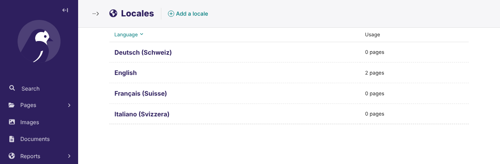

# Installation guide — Supertext Translation for Wagtail

For administrators and developers adding Supertext to a Wagtail site.

## Just want to try it?

`demo/` is a ready-to-run Wagtail 8 site with English sample content, German, French and Italian (Switzerland), wagtail-localize and this package. It is also what runs the public Supertext demo. See the *Demo* section of the [developer guide](DEVELOPER.md#demo-railway).

## Requirements

| | |
| --- | --- |
| Wagtail | 8.0 (tested), 7.0–7.4 (tested in CI) |
| wagtail-localize | 1.12 or newer |
| Python | 3.10 or newer (whatever your Wagtail needs) |
| Supertext | An account ([create one or log in](https://www.supertext.com/person/en/account/signin)) and an API key ([supertext.com → Integrations → API](https://www.supertext.com/en/integrations/api), needs the Admin role). See [Getting a Supertext account and API key](#getting-a-supertext-account-and-api-key). |
| Network | The server must reach `https://api.supertext.com` over HTTPS |

This package is a machine translator **for wagtail-localize**. If your site doesn't use wagtail-localize yet, set it up first: [wagtail-localize installation](https://wagtail-localize.org/stable/how-to/installation/). That includes `WAGTAIL_I18N_ENABLED = True`, `WAGTAIL_CONTENT_LANGUAGES` and making your page models translatable (Wagtail pages are by default).

## 1. Install the package

The package isn't on PyPI yet. Install it from GitHub:

```bash
pip install "wagtail-supertext-translation @ git+https://github.com/Supertext/Wagtail-Supertext-Translation@main"
```

## 2. Configure it

In your Django settings:

```python
import os

INSTALLED_APPS = [
    # ...
    "wagtail_supertext",          # adds Settings → Supertext and the supertext_check command
    "wagtail_localize",
    "wagtail_localize.locales",
    # ...
]

WAGTAILLOCALIZE_MACHINE_TRANSLATOR = {
    "CLASS": "wagtail_supertext.SupertextTranslator",
    "OPTIONS": {
        "API_KEY": os.environ.get("SUPERTEXT_API_KEY", ""),
    },
}
```

wagtail-localize uses one machine translator per site; this replaces DeepL or Google if you had one configured.

In your `urls.py`, add the plugin's public ping endpoint **before** Wagtail's catch-all pattern (it lets Supertext see that the site is reachable, see [Version information and the API key check](#version-information-and-the-api-key-check)):

```python
urlpatterns = [
    path("admin/", include(wagtailadmin_urls)),
    path("supertext/", include("wagtail_supertext.urls")),   # GET /supertext/ping, no login
    # ...
    path("", include(wagtail_urls)),
]
```

Then create the plugin's table (it keeps the latest API key check and what was last reported):

```bash
python manage.py migrate
```

### Getting a Supertext account and API key

1. **No Supertext account yet?** [Create one at supertext.com](https://www.supertext.com/person/en/account/signin) (the same page logs you in if you already have one).
2. **Generate your API key** at [supertext.com → Integrations → API](https://www.supertext.com/en/integrations/api). This requires the **Admin** role in your Supertext account; ask your Supertext account admin if you don't see the page.

**API key:** set the environment variable **`SUPERTEXT_API_KEY`** on the server. It always takes precedence over `API_KEY`, and keeps the key out of your code. You can use the key exactly as Supertext shows it, with the leading `Supertext-Auth-Key`, or without it.

## 3. Check it works

As a superuser, open **Settings → Supertext** in the Wagtail admin and click **Test connection**. *API key checked: the connection to Supertext works.* means everything is in place. The page also shows the installed plugin version (linked to its release notes on GitHub), the latest API key check with its time, whether version information is sent to Supertext (with the ping endpoint's address), and which Supertext language code and tone each locale gets, or *Not mapped* for a locale that still needs a Supertext language.


From the command line (checks the key, prints the result and sends a `check` version report if reports are on; exits with an error when Supertext doesn't accept the key):

```bash
python manage.py supertext_check
```

## 4. Locales

Supertext translates into the site's **locales** (*Settings → Locales*, from `WAGTAIL_CONTENT_LANGUAGES`). Each locale needs a Supertext language. Supertext accepts exactly these target codes (from its `features` list, October 2026):

| Language | Supertext codes |
| --- | --- |
| German, English, French, Italian, Portuguese | `de-DE`, `de-CH`, `de-AT`, `en-US`, `en-GB`, `fr-FR`, `fr-CH`, `it-IT`, `it-CH`, `pt-PT`, `pt-BR` |
| Chinese, Serbian | `zh-Hans`, `zh-Hant`, `sr-Latn`, `sr-Cyrl` |
| Swiss German | `gsw-u-sd-chzh` (Zurich), `gsw-u-sd-chbe` (Bern) |
| All others, without region | `bg`, `cs`, `da`, `el`, `es`, `fi`, `hr`, `hu`, `ja`, `ko`, `nb`, `nl`, `pl`, `rm`, `ru`, `sk`, `sl`, `sq`, `sv`, `tr` |

- A locale whose Wagtail code **is** one of these codes (apart from upper/lower case and `_`/`-`) is used as it is: `de-ch` → `de-CH`, `fr-ch` → `fr-CH`, `es` → `es`.
- **Every other locale needs a mapping**: `code` under `LANGUAGES` (below), e.g. `de` → `de-CH`, `zh-cn` → `zh-Hans`, `es-es` → `es`. The plugin never guesses a region: an unmapped locale gets the message *The language … has no Supertext language yet* in the translation editor, and nothing is sent to Supertext. *Settings → Supertext* marks it **Not mapped**.
- The source language is sent without region (`en-gb` → `en`; a mapped source uses the language of its mapping).
- Translating within one language (`en` → `en-GB`) isn't offered.



### Language mapping and tone

Per locale (keyed by its Wagtail language code), `code` is the Supertext language it is sent as (it wins over the exact match), and `politeness` is the tone:

```python
"OPTIONS": {
    "API_KEY": os.environ.get("SUPERTEXT_API_KEY", ""),
    "LANGUAGES": {
        "fr": {"code": "fr-CH", "politeness": "more"},  # Swiss French, formal (vous)
        "de": {"code": "de-CH", "politeness": "less"},  # Swiss German, informal (du)
        "zh-cn": {"code": "zh-Hans"},                    # Chinese (Simplified)
    },
},
```

`politeness`: `more` = formal (*Sie, vous*), `less` = informal (*du, tu*), otherwise Supertext's default. Supertext offers no formal/informal choice for English, Swiss German, Romansh, Albanian and Serbian: leave `politeness` out for those. If it is set anyway, the plugin doesn't drop it silently: the editor gets *Supertext offers no formal or informal tone for this language*, nothing is sent, and *Settings → Supertext* shows a warning next to the tone.

## Version information and the API key check

**Send version information to Supertext** is on by default. The plugin then sends the site URL and the versions of this plugin, Wagtail and Python to Supertext after an update and when the API key changes, so Supertext support can see which version you run. A report contains exactly: the site URL (`WAGTAILADMIN_BASE_URL`, else the address the admin request came in on, else the default site's root URL), the plugin's name (`Wagtail-Supertext-Translation`) and version, the Wagtail and Python versions, the Supertext SDK version, whether an API key is set, the result of the API key check below (status, time, HTTP status, Supertext's error code) and the address of the ping endpoint. **No content, no API key and no personal data are sent.** Reports go from the Wagtail server, never from the browser, in the background: a report that fails is not retried for an hour and never slows down or breaks a translation.

Turn it off with `"VERSION_REPORTS": False` in the `OPTIONS`, or the environment variable `SUPERTEXT_VERSION_REPORTS=0` (it wins over the option; `1` turns it on). Nothing is sent at all then, and the ping endpoint answers 404. *Settings → Supertext* shows whether it is on and where that comes from.

**The API key check** runs whether or not version information is sent: when the plugin first runs with a key it hasn't checked yet (on *Settings → Supertext* or a translation; the key is compared by a SHA-256 fingerprint kept in the database, never the key itself), on **Test connection**, with `manage.py supertext_check`, and when Supertext rejects the key during a translation. It's Supertext's cost-free `features` call; nothing is translated or billed. *Settings → Supertext* shows the latest result with its time: *the connection works*, *Supertext rejected the API key* (with the links to create an account and generate a key), *no API key is set*, *Supertext can't be reached* or *Supertext answered with an error*.

**The ping endpoint** `GET <site>/supertext/ping?challenge=…` (from `wagtail_supertext.urls`, see [Configure it](#2-configure-it)) needs no login and answers only `{"ok":true,"plugin":"Wagtail-Supertext-Translation","challenge":"…"}`, so Supertext can see that the site is reachable from the internet. It returns nothing else: no versions, no settings, no data, and it is never cached. Without the URL pattern, reports are sent without a ping address and *Settings → Supertext* says how to add it.

The plugin keeps its state (what was reported last, the latest key check, never the key) in the table `wagtail_supertext_supertextstate`, created by `migrate`.

## Who can translate

wagtail-localize's own permissions apply: editors need **Can submit translation** (*Settings → Groups → Wagtail Localize*) and edit permission on the pages. Anyone who can edit a translation can use **Translate with Supertext** in it. *Settings → Supertext* is for superusers only.

## Interface languages

*Settings → Supertext* and the plugin's messages are available in English, German, French and Italian. They follow each user's Wagtail admin language (*Account → Preferences → Preferred language*; `WAGTAILADMIN_PERMITTED_LANGUAGES` limits the choice). Other languages fall back to English. The `manage.py supertext_check` output is English only.

## All settings (`OPTIONS`)

| Option | Default | Purpose |
| --- | --- | --- |
| `API_KEY` | – | Supertext API key, with or without the `Supertext-Auth-Key` prefix. The `SUPERTEXT_API_KEY` environment variable wins. |
| `ENVIRONMENT` | `"live"` | `"live"`, `"staging"` or `"testing"` Supertext API |
| `ENDPOINT` | – | Custom API base URL (overrides `ENVIRONMENT`). The `SUPERTEXT_API_ENDPOINT` environment variable wins. |
| `LANGUAGES` | `{}` | Per Wagtail language code: `code`, the Supertext language (the language mapping, e.g. `de-CH`, `es`, `zh-Hans`; needed for every locale whose code isn't itself a Supertext code, see [Locales](#4-locales); no default regions) and `politeness` (`more`/`less`, only for languages that offer it) |
| `TIMEOUT` | `180` | Seconds to wait for one translation |
| `POLL_INTERVAL` | `2` | Seconds between status checks |
| `VERSION_REPORTS` | `True` | *Send version information to Supertext* (see [Version information](#version-information-and-the-api-key-check)). The `SUPERTEXT_VERSION_REPORTS` environment variable (`0`/`1`) wins. |

## Updating

```bash
pip install -U "wagtail-supertext-translation @ git+https://github.com/Supertext/Wagtail-Supertext-Translation@main"
```

Then run `python manage.py migrate` (version 0.2 adds the plugin's own table). After an update, the next admin request that runs the plugin reports the new version to Supertext (if version information is on).

## Uninstalling

Run `python manage.py migrate wagtail_supertext zero` (drops the plugin's table), remove `WAGTAILLOCALIZE_MACHINE_TRANSLATOR` (or point it at another translator), the `wagtail_supertext.urls` line and `"wagtail_supertext"` from `INSTALLED_APPS`, then `pip uninstall wagtail-supertext-translation`. Existing translations stay.

## Troubleshooting

| Message / symptom | Cause / fix |
| --- | --- |
| No **Translate with Supertext** button in the translation editor | `WAGTAILLOCALIZE_MACHINE_TRANSLATOR` isn't set to `wagtail_supertext.SupertextTranslator`. *Settings → Supertext* shows a warning then. The button is also missing when source and target end up as the same Supertext language. |
| *No Supertext API key is configured* | Set `SUPERTEXT_API_KEY` (or `API_KEY`) and restart. No key yet? Generate one at [supertext.com → Integrations → API](https://www.supertext.com/en/integrations/api) (Admin role). |
| *Authentication failed* | The key is wrong or revoked. Check it with **Test connection**, or generate a new one at [supertext.com → Integrations → API](https://www.supertext.com/en/integrations/api). |
| *Too many requests to Supertext* | Supertext's per-second limit was still exceeded after 4 automatic retries. Wait a moment and try again. |
| *Your Supertext translation limit is exceeded* | Your Supertext plan's volume is used up. |
| *The language … has no Supertext language yet* / **Not mapped** on *Settings → Supertext* | The locale's Wagtail code isn't a Supertext code (e.g. `de`, `es-es`, `zh-cn`): set `LANGUAGES` → `code` for it (see [Locales](#4-locales)) and restart. Nothing was sent to Supertext. |
| *Supertext does not support this language pair* | A mapped code Supertext doesn't offer (e.g. `es-ES` instead of `es`, or the same language as the source). Fix the `LANGUAGES` → `code` entry. The message shows the codes that were sent. |
| *Supertext offers no formal or informal tone for this language* | `politeness` is set for a language without it (English, Swiss German, Romansh, Albanian, Serbian); remove it for that locale. |
| *Supertext rejected the API key* (API key check) | The key is wrong or revoked. Check that the whole key was copied into `SUPERTEXT_API_KEY` (or `API_KEY`), or generate a new one at [supertext.com → Integrations → API](https://www.supertext.com/en/integrations/api) (Admin role). No Supertext account yet? [Create one at supertext.com](https://www.supertext.com/person/en/account/signin). Restart, then **Test connection**. |
| *The API key couldn't be checked because Supertext can't be reached* | The server can't reach `api.supertext.com` (firewall, proxy, DNS). Translations need the same connection. |
| *Settings → Supertext* says the ping endpoint isn't installed | Add `path("supertext/", include("wagtail_supertext.urls"))` to `urls.py` before `wagtail_urls`. |
| *Timed out waiting* | Very long pages: raise `TIMEOUT`, and your web server's request timeout (e.g. gunicorn `--timeout`). |
| *Could not reach Supertext* | The server can't make outbound HTTPS calls; check firewall or proxy (`HTTPS_PROXY`). |

Errors are shown to the editor in the translation editor and logged by Django.

## Security notes

- Prefer the `SUPERTEXT_API_KEY` environment variable: the key then never sits in your repository.
- Documents are deleted from Supertext right after download (and expire after 24 hours anyway).
