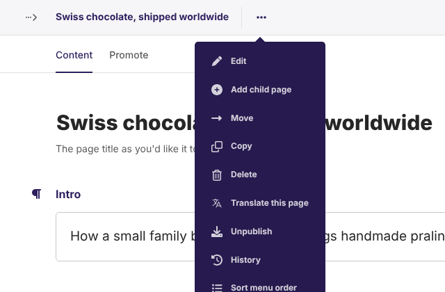
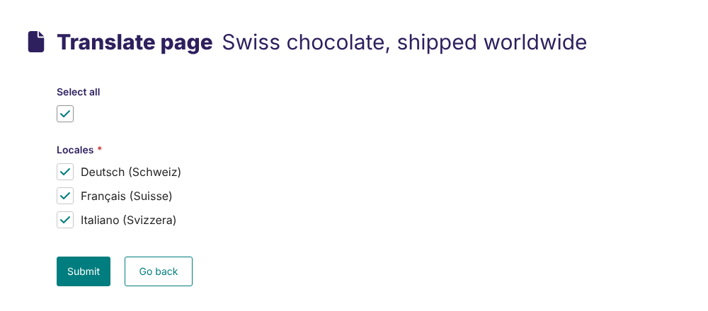
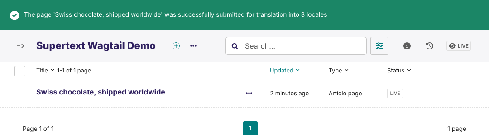
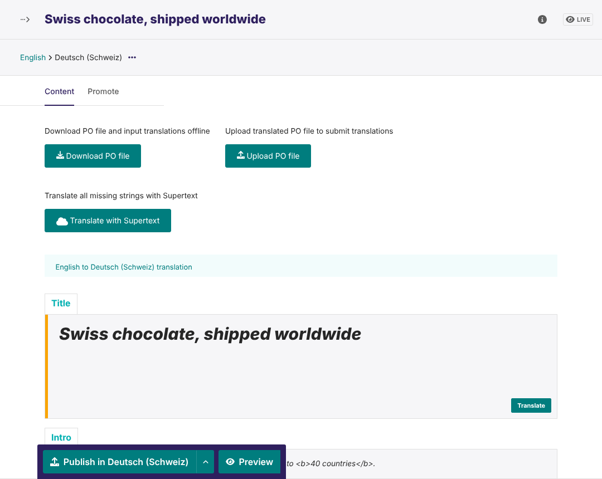
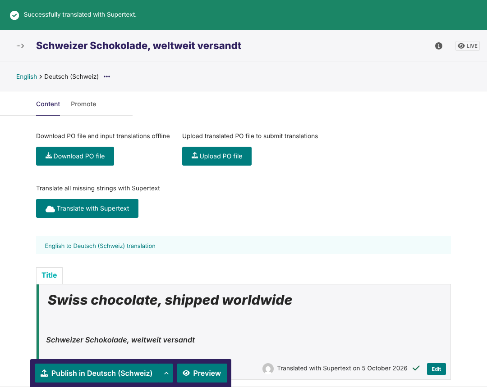
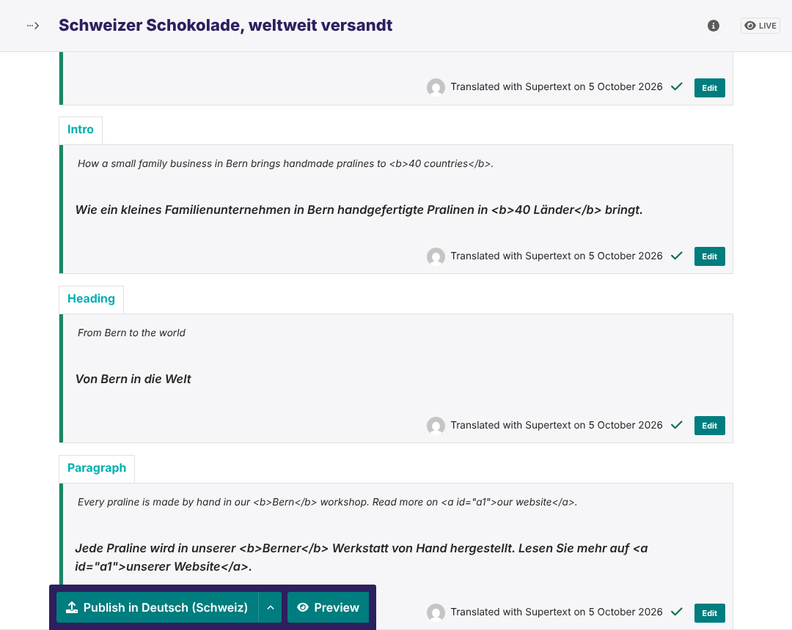
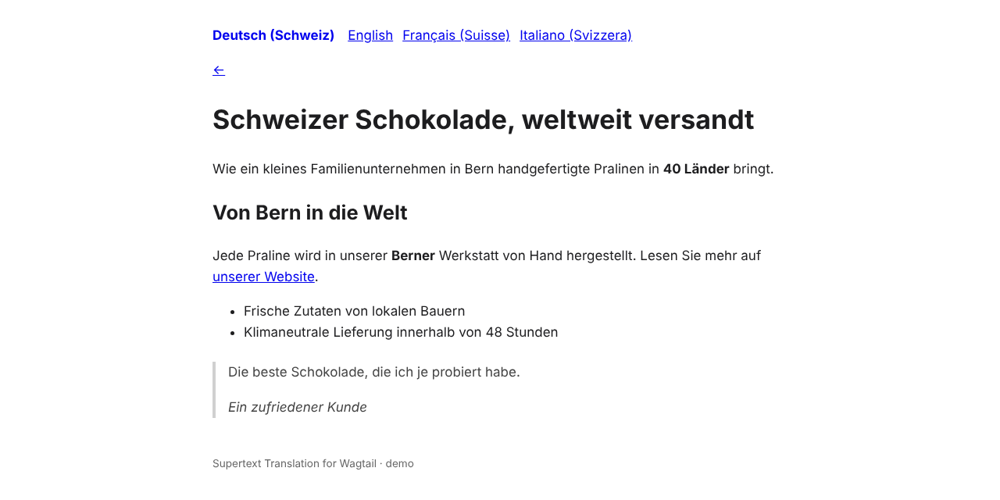
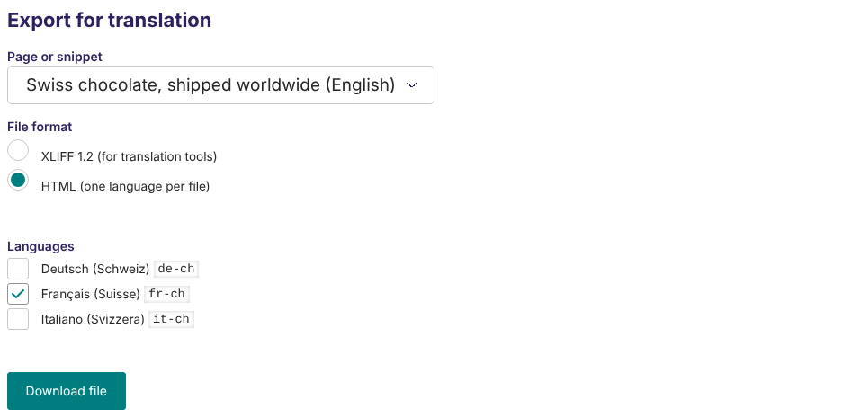
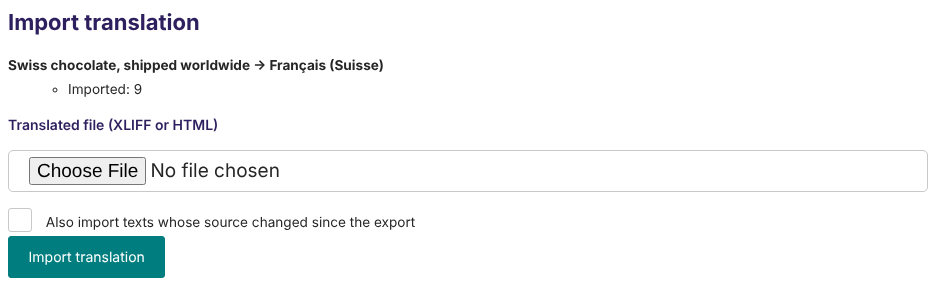

# User guide — Supertext Translation for Wagtail

For editors. Your site translates pages with **wagtail-localize**, Wagtail's translation tool; Supertext fills in the translations for you. You review them and publish.

## Try it on the demo

The Supertext Wagtail demo (ask Supertext for the address and a login) has an English home page and article, and German, French and Italian (Switzerland) as further languages. Translate the article as described below, publish, and switch languages at the top of the page on the site.

## Translate a page

*Screenshots: Wagtail 8 with the demo content.*

1. Open the page in the editor, click **⋯** (More actions) at the top and choose **Translate this page**.

   

2. Tick the languages (or **Select all**) and click **Submit**. To translate a whole section, tick *Include subtree* if it's offered.

   

   Wagtail creates a draft of the page in each language and confirms it.

   

3. Open the page in one of the new languages (e.g. via the language menu next to the title). This is the **translation editor**: every text of the page in English, with a slot for its translation.

   

4. Click **Translate with Supertext**. After a few seconds all texts are filled in, marked *Translated with Supertext*.

   

   Formatting and links stay in place:

   

5. Check the texts. To change one, click **Edit** next to it. Then click **Publish in Deutsch (Schweiz)** (or save a draft).

   

Repeat steps 3–5 for the other languages.

## When the English page changes

After editing the original, open the translation and choose **Sync translated pages** (in the original's **⋯** menu) or update the translation. New or changed texts appear untranslated; **Translate with Supertext** translates **only those**. Texts that already have a translation, including ones you edited, are never overwritten. To have Supertext translate a text again, clear its translation (**Edit** → delete the text → save) and click **Translate with Supertext**.

## Export for translation and import translated files

Instead of *Translate with Supertext*, you can download the texts of a translation as a file, have it translated elsewhere and import the result. This is the plugin's own XLIFF/HTML export, under **Settings → Translation files**; it is not the same as wagtail-localize's **Download PO file** / **Upload PO file** in the translation editor (PO files are for gettext tools; XLIFF is what most translation tools and agencies expect, and HTML files can go to Supertext's web app). The texts you import appear in the translation editor exactly like a machine translation: review them and publish there.

First start the translation as usual (**Translate this page**, steps 1–2 above), so the translated page exists. Then:

**Export for translation**

1. Open **Settings → Translation files** and choose the page or snippet under **Page or snippet** (only translations you may edit are listed).
2. Choose the **File format**:
   - **XLIFF 1.2 (for translation tools)**: one file for one or more languages. Choose this for translation tools such as Trados, memoQ or Phrase: formatting becomes protected tags that translators can move but not break.
   - **HTML (one language per file)**: exactly one language. You can upload it to Supertext's web app or give it to anyone who translates HTML. Translators must leave the file's head and the `data-st-id` attributes alone.
3. Tick the **Languages** and click **Download file**. The file has the same texts *Translate with Supertext* would send: the texts without a translation yet in that language. When everything is translated already, it says *Nothing to translate.*

Send the file to your translator or translation agency, or upload it to Supertext's web app.

**Import translation**

1. On the same page, choose the translated file under **Import translation** (XLIFF or HTML, at most 10 MB). The file says which translation it belongs to.
2. Tick **Also import texts whose source changed since the export** if texts edited in the original after the export should still be imported (off by default: they would no longer match).
3. Click **Import translation**, then open the translation in the translation editor, check the texts and publish.

As with *Translate with Supertext*, texts that already have a translation (including ones you edited after the export) are never overwritten.

The summary lists each page or snippet and language from the file:

| Line | Meaning |
| --- | --- |
| *Imported: n* | Texts written into the translation. |
| *Skipped, source changed since the export: n* | The original text was edited after the export; tick *Also import texts whose source changed since the export* to import them anyway. |
| *Not translated in the file: n* | The translator left these empty (XLIFF only). |
| *Formatting changed, not imported: n* | The translation broke or added formatting (tags, links); fix it in the file and import again. |
| *Not in the file: n* | Texts that still need a translation but weren't in the file (e.g. added after the export). |

An HTML file can't mark a text as untranslated: imported unchanged, it writes the original text into the translation. Errors: *This file isn't a valid XLIFF or HTML translation file*, *This file wasn't exported by the Supertext plugin, or its header was removed*, *This file belongs to another system (…)* (exported by another Supertext plugin), *The page or snippet this file was exported from is no longer being translated* (the translation was stopped or deleted), *The site has no language …*, *You are not allowed to edit this page or snippet*, *The file is too large (at most 10 MB)*.

## What gets translated

Everything wagtail-localize offers for translation: titles, rich text (whole paragraphs, with bold, italic and links kept), text fields, StreamField blocks, SEO and search texts, and snippets that are set up for translation. The page's URL slug is translated too, so the German page gets a German URL.

## What is *not* translated

- Images, documents, link targets, numbers and dates: wagtail-localize keeps them from the original (or lets you choose another image per language).
- Fields your developers marked as not translatable.
- Texts that already have a translation.

## Formal and informal language

Your administrator sets per language whether Supertext writes formally (*Sie/vous*) or informally (*du/tu*).

## When something goes wrong

Supertext's messages follow your Wagtail admin language (English, German, French or Italian; set it under *Account → Preferences → Preferred language*).

If Supertext can't translate, the translation editor shows a red message starting with *Supertext could not translate*; nothing is changed, so you can try again.

| Message | What to do |
| --- | --- |
| *No Supertext API key is configured* | Ask your administrator to set up Supertext. The message links to the page where a Supertext admin generates the key ([supertext.com → Integrations → API](https://www.supertext.com/en/integrations/api)). |
| *Authentication failed* | The API key is wrong; ask your administrator to generate a new one at [supertext.com → Integrations → API](https://www.supertext.com/en/integrations/api). |
| *The language … has no Supertext language yet* | Your administrator hasn't told the plugin which Supertext language to use for this locale. Ask them to choose one under *Settings → Supertext → Languages*; nothing was sent to Supertext. |
| *Supertext does not support this language pair* | One of the languages isn't one Supertext translates; ask your administrator to check *Settings → Supertext → Languages*. |
| *Supertext offers no formal or informal tone for this language* | The tone set for this locale isn't available in that language (e.g. English); ask your administrator to set it to the default. |
| *Too many requests to Supertext* | Wait a moment and try again. |
| *Your Supertext translation limit is exceeded* | Your organisation's Supertext volume is used up; contact your administrator. |
| *There isn't anything left to translate* | All texts already have a translation. |
| *Timed out waiting …* | Very long page: try again, or ask your administrator to raise the timeout. |
